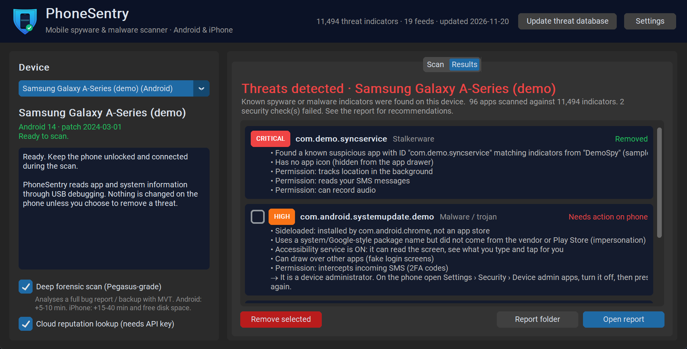
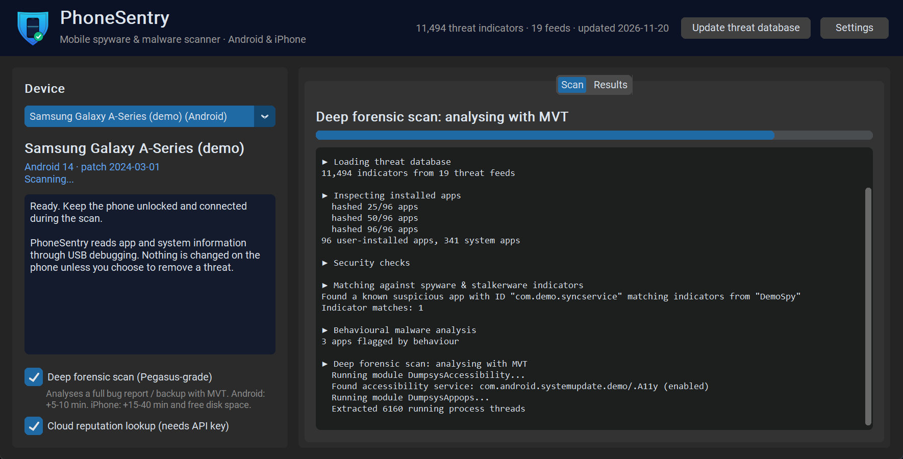
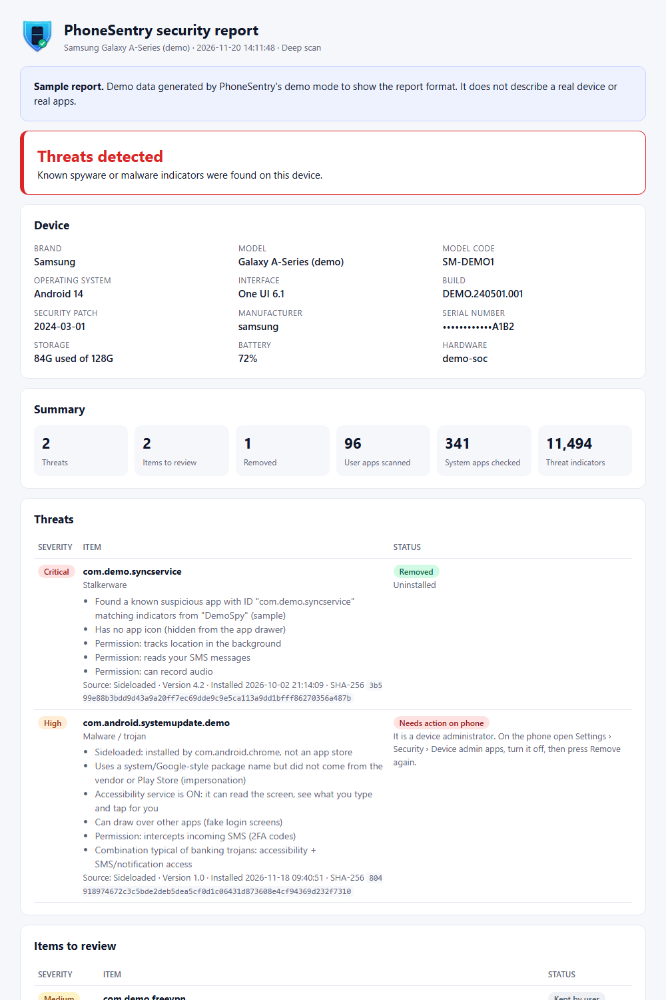
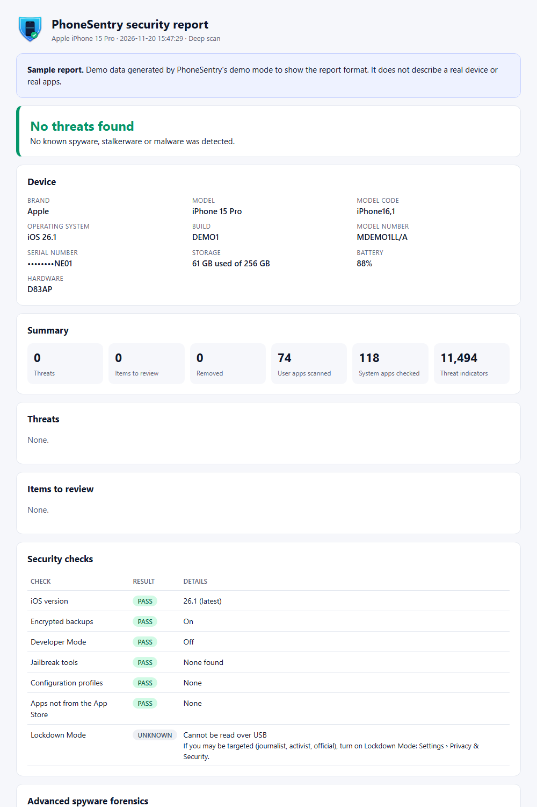

<p align="center">
  
</p>

<h1 align="center">PhoneSentry</h1>

<p align="center">
  <b>Scan Android phones and iPhones for Pegasus-class spyware, stalkerware and malware from a Windows PC.</b><br>
  Plug in a phone, press Scan, get a clear report and remove what it finds.
</p>

<p align="center">
  <a href="https://github.com/waleedmustafa971/PhoneSentry/releases/latest/download/PhoneSentry.exe"><b>⬇ Download for Windows</b></a> ·
  <a href="https://phonesentry.vercel.app">Website</a> ·
  <a href="https://phonesentry.vercel.app/samples/sample-threats/report.html">Sample report</a>
</p>

<p align="center">
  <a href="https://github.com/waleedmustafa971/PhoneSentry/releases/latest"></a>
  <a href="https://github.com/waleedmustafa971/PhoneSentry/actions/workflows/build.yml"></a>
  
  <a href="LICENSE"></a>
</p>



## Features

- **Mercenary spyware detection.** Checks against 11,000+ public indicators of compromise for NSO Pegasus, Intellexa Predator, Candiru, QuaDream, Operation Triangulation, NoviSpy and more, using Amnesty International's [Mobile Verification Toolkit](https://github.com/mvt-project/mvt) (MVT).
- **Stalkerware detection.** Covers 190+ commercial stalkerware families from the [Echap](https://github.com/AssoEchap/stalkerware-indicators) feed.
- **Trojan and malware detection.** Scores every app on behaviour: sideloading, accessibility and device-admin abuse, SMS and notification interception, screen overlays, hidden icons, and apps posing as system packages.
- **Deep forensic scan.** Analyses a full Android bug report or an encrypted iPhone backup with MVT's forensic modules (SMS links, browser history, data-usage records, app ops, battery history and more).
- **Optional cloud reputation.** Looks up sideloaded APK fingerprints on VirusTotal (70+ engines) and MalwareBazaar with your free API key. Only hashes leave the PC.
- **Security checks.** Bootloader and verified boot, root/jailbreak, SELinux, patch age, Play Protect, proxies, private DNS, VPNs, configuration profiles, Developer Mode and more.
- **Removal.** Tick a threat and remove it. Android apps are stopped, lose accessibility access and are uninstalled; iPhone apps and configuration profiles are removed.
- **Clear report.** An HTML + JSON report with the phone's brand, model, OS and patch level, plus findings, actions taken and prioritised recommendations.
- **Self-contained.** One exe. adb and the threat database are built in; no Python or SDK needed.

## Screenshots

| Scanning | Sample report: threats found | Sample report: clean iPhone |
|---|---|---|
|  | [](website/samples/sample-threats/report.html) | [](website/samples/sample-clean/report.html) |

*Screenshots and sample reports use fictional demo data (`python -m phonesentry.demo`).*

## Quick start

1. [Download `PhoneSentry.exe`](https://github.com/waleedmustafa971/PhoneSentry/releases/latest/download/PhoneSentry.exe) and run it. It's unsigned, so on first launch Windows SmartScreen asks you to confirm: click **More info › Run anyway**. You can [verify the checksum](SECURITY.md#verifying-downloads).
2. Connect the phone:
   - **Android:** Settings › About phone › tap *Build number* 7 times, then Developer options › **USB debugging** ON. Plug in, unlock, tap **Allow**.
   - **iPhone:** install [Apple Devices](https://apps.microsoft.com/detail/9np83lwlpz9k) (or iTunes) for the USB driver. Plug in, unlock, tap **Trust**.
3. Press **Start scan**. A quick scan takes about 1 minute. A deep scan takes 5-10 minutes on Android and 15-40 minutes on iPhone, depending on how much data the phone holds.
4. Review the results, remove threats if you want to, and open the report.

Reports are saved to `Documents\PhoneSentry Reports\`.

## How detection works

| | Android | iPhone |
|---|---|---|
| Spyware & stalkerware indicators | package names, APK SHA-256, app processes, system properties | bundle IDs, configuration profiles |
| Deep forensic scan (MVT) | `adb bugreport`: accessibility, app ops, battery history, processes, receivers, settings, tombstones... | encrypted backup: SMS/iMessage links, Safari/Chrome history, DataUsage process records, TCC, WebKit, profiles... |
| Behavioural malware engine | ✔ | App Store vs enterprise/developer signing, jailbreak tools |
| Cloud reputation | VirusTotal, MalwareBazaar (optional) | n/a |
| Removal | uninstall (device admins need one tap on the phone) | apps, configuration profiles |

Pegasus-class implants on iOS live in system memory: no tool can delete them. When they're detected, the report explains the next steps: preserve evidence, contact [Amnesty Security Lab](https://securitylab.amnesty.org/get-help/) or [Access Now](https://www.accessnow.org/help/), update iOS, reboot, and turn on Lockdown Mode.

## Privacy

- Everything runs locally. Phone data never leaves the computer.
- Raw bug reports and backups are deleted after a deep scan unless you choose to keep them.
- Serial numbers are masked in reports.
- Cloud lookups are off until you add an API key, and they send only app fingerprints.
- Every scan starts with an informed-consent confirmation. Only scan phones you own, or whose owner has agreed.

**Limitations.** A clean result lowers the likelihood of known threats but can't prove a phone is uncompromised. Unknown or brand-new spyware may leave no visible trace.

## Building from source

Requirements: Windows 10/11, Python 3.14, PowerShell.

```powershell
git clone https://github.com/waleedmustafa971/PhoneSentry.git
cd PhoneSentry
powershell -ExecutionPolicy Bypass -File build.ps1              # -> dist\PhoneSentry.exe
powershell -ExecutionPolicy Bypass -File build.ps1 -UpdateIocs  # refresh the bundled threat feeds first
```

`build.ps1` creates a virtualenv, downloads Google's adb and the latest MVT indicator feeds, generates the logo and runs PyInstaller. `installer.iss` builds an optional setup wizard with [Inno Setup](https://jrsoftware.org/isdl.php).

**Command line** (same exe or `python run_phonesentry.py`):

```text
PhoneSentry.exe --list                          connected devices
PhoneSentry.exe --scan [--deep] [--serial X]    scan without the GUI
PhoneSentry.exe --analyze-bugreport file.zip    analyse an existing Android bug report
PhoneSentry.exe --update-iocs                   update threat feeds
```

### Project layout

| Path | |
|---|---|
| `phonesentry/gui.py` | desktop app (CustomTkinter) |
| `phonesentry/android_scan.py` | adb collection, security checks, indicator matching, removal |
| `phonesentry/ios_scan.py` | iPhone pairing, apps and profiles, backup + decryption, removal |
| `phonesentry/heuristics.py` | behavioural malware scoring |
| `phonesentry/mvt_runner.py` | runs MVT forensic modules in-process |
| `phonesentry/iocs.py`, `cloud.py` | threat feeds; VirusTotal / MalwareBazaar |
| `phonesentry/report.py` | HTML/JSON report and recommendations |
| `phonesentry/demo.py` | fictional sample scans for docs and screenshots |
| `website/` | project website (static, deployed on Vercel) |

## Contributing

Issues and pull requests are welcome, especially false-positive reports (attach the anonymised `report.json`, never a full bug report or backup) and new heuristics. See [SECURITY.md](SECURITY.md) for reporting vulnerabilities.

## License

PhoneSentry is free software under the [GNU GPL v3](LICENSE). It bundles third-party components under their own licences; see [THIRD_PARTY_NOTICES.md](THIRD_PARTY_NOTICES.md). In particular, MVT's licence requires the **informed consent of the phone's owner** for every scan.

Spyware indicators are published by Amnesty International, Citizen Lab, Echap and other researchers through the [mvt-indicators](https://github.com/mvt-project/mvt-indicators) project. PhoneSentry is independent and is not affiliated with or endorsed by them.
